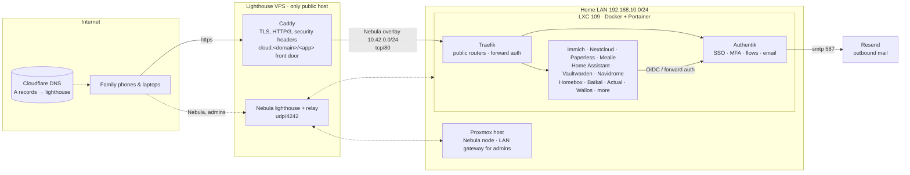

# HeardOS

A family cloud: photos, recipes, documents, music, passwords, calendars, a home-automation hub and a few
household tools, all behind one sign-in, reachable from anywhere, with nothing but a single VPS on the public
internet. This repository is the set of scripts, configs, templates and documentation that build and operate it.

<p align="center"></p>

## How it is put together



A detailed, annotated map of every host, route and app is in [`docs/network-map.svg`](docs/network-map.svg)
(interactive version: [`docs/network-map.html`](docs/network-map.html)).

**The shape of it**

- **One public host.** A small VPS runs Caddy for TLS and a Nebula lighthouse. Its only open ports are 80, 443 and
  udp/4242; SSH is reachable solely over the overlay. Everything else lives at home.
- **A private overlay.** [Nebula](https://github.com/slackhq/nebula) joins the VPS, the Proxmox host, the app container
  and admin laptops into 10.42.0.0/24. Caddy proxies every public hostname across it to Traefik at home, so no port is
  forwarded on the home router and the home IP never appears in DNS. Admins can also reach the whole home LAN through
  the Proxmox node (`nebula-lan/`).
- **One sign-in.** [Authentik](https://goauthentik.io) fronts every app, either as an OIDC provider or through Traefik
  forward auth. Behaviour is assigned by group membership: MFA required, suspended, 8-hour sessions, recovery allowed,
  self-service, explicit consent (`authentik/business-flows.py`). Emails are branded (`authentik/email-templates/`)
  and go out through Resend.
- **Apps as Portainer stacks.** The app host is an unprivileged Proxmox LXC running Docker, with each app a plain
  Compose stack managed by Portainer (`generic/stacks/` holds the parameterised versions). Until 2026-10-17 the apps ran
  on Runtipi; `host/` and `docs/portainer-migration-plan.md` keep that history.
- **A front door.** `https://cloud.<domain>/<slug>` redirects to each app's real hostname, so people only need to
  remember one address; the family hub (Homepage) and the dashboard link through it.

## The dev environment: one distrobox on the laptop

Everything you run from the admin laptop runs inside one [distrobox](https://distrobox.it) container called
`heardos-dev`: the installer (GUI and CLI) and its tests, the `generic/` kit scripts that run laptop-side, the Nebula
and LAN certificate authorities, Caddyfile checks, the port scan, brand and doc-map renders. The laptop itself only
needs podman and distrobox, so an immutable desktop (Fedora Atomic, Bazzite, …) stays untouched and the toolchain is
one file: [`devbox/distrobox.ini`](devbox/distrobox.ini).

```bash
distrobox assemble create --file devbox/distrobox.ini   # build the box (a few minutes, once)
distrobox enter heardos-dev
devbox/setup.sh                                         # installer venv + tool check + unit tests (re-runnable)
```

**What's in it** (Fedora 44 toolbox image):

| For | Tools |
|---|---|
| The installer | Python 3, a venv at `installer/.venv` with the installer and its dev extras (pytest, respx, pyinstaller), GL/X11/Wayland client libraries so the imgui GUI opens on the laptop's desktop |
| Remote work | git, gh, openssh, rsync, curl, jq, dig, sqlite3, envsubst, aria2 |
| The edge and certificates | `caddy` (validate a Caddyfile before it goes to the lighthouse), `nebula-cert`, `step` (smallstep CLI, for the offline LAN CA root), gnupg (CA backups) |
| Checks and assets | nmap (`security/portscan.sh`), ShellCheck, ImageMagick and Pillow (brand renders) |

**How it fits the laptop.** A distrobox shares your home directory and the laptop's network:

- `~/.ssh`, `~/.config/credentials.env` (0600), `~/.config/nebula-ca`, the LAN CA root and the installer's
  `~/.config/heardos/` vault are the same files inside and out. Nothing secret is baked into the image.
- The Nebula overlay keeps running as the laptop's own `nebula` service; the box simply sees `10.42.0.0/24` and, through
  the Proxmox node, the home LAN. Don't run a second Nebula inside the box.
- Things that change the laptop itself run on the host: `security/laptop-firewall-tighten.sh` (firewalld) and the
  `nebula-lan/` client hook. From inside the box, prefix them with `distrobox-host-exec`.

**Day to day** (inside the box, from the repo root):

| Task | Command |
|---|---|
| Unit tests | `cd installer && .venv/bin/pytest -q tests/unit` |
| Installer GUI, sample data only | `HEARDOS_UI_DEMO=1 installer/.venv/bin/heardos` |
| Whole install plan, nothing executed | `installer/.venv/bin/heardos-cli install --plan installer/tests/e2e/plan.example.json --dry-run --yes` (after `heardos-cli init` and `heardos-cli secret NAME` for the provider and DNS tokens it asks for) |
| Render and syntax-check the edge Caddyfile | `HEARDOS_ENV=generic/heardos.env CADDY_FRONT_DOOR=1 python3 generic/lib/caddyfile.py > /tmp/Caddyfile && caddy adapt --adapter caddyfile --config /tmp/Caddyfile >/dev/null` (`caddy validate` also opens the lighthouse's log file, so run that one on the lighthouse) |
| Nebula CA and node bundles | `generic/20-nebula-ca.sh init` · `generic/20-nebula-ca.sh sign NAME IP GROUPS` |
| Regenerate the network map | `python3 docs/network-map-src/gen.py` (writes `heardos-map.svg` + `index.html` next to it; copy over `docs/network-map.*` when happy) |
| External exposure check | `bash security/portscan.sh` |
| Lint the shell scripts | `shellcheck generic/*.sh` |

**Keeping it current.** `distrobox upgrade heardos-dev` updates the packages. After editing `devbox/distrobox.ini`,
rebuild with `distrobox assemble create --replace --file devbox/distrobox.ini` and re-run `devbox/setup.sh`. Your
files aren't affected, because they live in your home directory, not the container. To remove it: `distrobox rm heardos-dev`.

The `step` CLI comes from smallstep's own RPM (it isn't in Fedora's repositories); dnf installs it from the URL without
a signature check. On macOS, where distrobox doesn't exist, follow the venv steps in
[`installer/README.md`](installer/README.md#development) and install the tools with Homebrew.

## Repository layout

| Path | What it holds |
|---|---|
| `devbox/` | The laptop dev environment: `distrobox.ini` (the toolchain) and `setup.sh` (installer venv, tool check, tests). |
| `installer/` | The desktop installer and day-two console (imgui GUI + `heardos-cli`) that drives the `generic/` kit; see its [README](installer/README.md). |
| `generic/` | A from-scratch rebuild kit for any x86-64 Ubuntu host + any VPS: numbered scripts (`10-host-bootstrap.sh` → `90-verify.sh`), compose stacks, a plan file (`heardos.env.example`). Start here if you want to build your own. |
| `edge/` | The lighthouse as it actually runs: `Caddyfile` (TLS, headers, the cloud front door, brand asset hosting), Nebula configs for lighthouse and Proxmox node, the node installer, Cloudflare DNS helpers, and `kasm-egress/` (full-tunnel egress, kill switch and inbound filter for the remote-browser VM). |
| `host/` | The app host as it ran on Runtipi until 2026-10-17: Traefik public/local router files, per-app Runtipi overrides (secrets redacted), the Runtipi API helper `tipi.py`, Nextcloud/Immich/calendar helpers. |
| `authentik/` | Group-driven business flows and their test harness, the recovery flow builder, launch-URL tool, the branded email kit and its render check, and the sign-in background generator. |
| `security/` | The written security baseline, a re-runnable read-only posture check, the external port scan, and the remediation scripts from the 2026-10 audit, the laptop firewalld tightening, CrowdSec for the edge (the kit installs it with `generic/33-vps-crowdsec.sh`; the GUI installer offers it as an option) and the step-ca LAN CA. |
| `mail/` | Resend set-up and DNS verification. |
| `nebula-lan/` | Reaching the home LAN over the overlay: router-side (Proxmox) and client-side (laptop) scripts. |
| `apps/` | Custom pieces: the HeardOS desktop (`dash/`: apps in windows, signed in through Authentik, plus this week's widgets), Homepage hub config, the trimmed LibreSpeed page, Actual Budget tooling, the Actual → Wallos subscription sync, the cookbook importer, the per-app Hearth theme files (`brand-theme/`), the HortusFox plant template, the paperless-gpt CPU benchmark, the Kiwix ZIM downloader (`kiwix/`), the SearXNG config templates (`searxng/`) and the Maintenance console (`tools/`: OliveTin config that turns the CronMaster script library into buttons in the desktop). |
| `brand/` | The HeardOS identity ("Hearth Crest"): SVG marks, lockups, icons, palette, the sign-in background. |
| `docs/` | Architecture, security baseline, flow and email documentation, operations notes, the Runtipi → Portainer migration plan. |

## Documentation

- [Architecture and request flow](docs/architecture.md)
- [Security baseline and audit findings](docs/security-baseline.md)
- [Security review 2026-10-19: status of every finding](docs/security-review-2026-10-19.md)
- [Authentik: group-driven flows](docs/authentik-flows.md)
- [Authentik: branded email kit](docs/email-kit.md)
- [Outbound mail through Resend](docs/outbound-mail.md)
- [The cloud front door](docs/front-door.md)
- [Home LAN over Nebula](docs/lan-over-nebula.md)
- [Remote browser egress through the lighthouse](docs/kasm-egress.md)
- [Skipping app login pages when already signed in](docs/sso-auto-redirect.md)
- [Trusted certificates for LAN names (step-ca)](docs/lan-ca.md)
- [Plants, newsletters and saved pages](docs/household-apps.md)
- [AI filing for Paperless on a CPU](docs/paperless-gpt.md)
- [Offline Wikipedia and private search](docs/wiki-search.md)
- [The HeardOS desktop: apps in windows, already signed in](docs/web-desktop.md)
- [One look across the apps](docs/hearth-theme.md)
- [Operating Runtipi: things that bite](docs/runtipi-notes.md)
- [Brand package](brand/README.md)

## Conventions you will see everywhere

- **Secrets never live in the repo.** Scripts read `~/.config/credentials.env` (mode 0600) on the operator's machine (shared into the dev box, never copied into it), or
  generate secrets at install time into the host's own secrets file. Anything that had a literal secret in the
  working copy is `<REDACTED>` here.
- **Idempotent scripts.** Nearly every script can be re-run; it finds what exists and only creates or re-asserts what
  is missing. Most have a `--dry-run`.
- **Verify, then trust.** Changes end with a check: a render, an HTTP probe, a posture check, a test user driven
  through a flow. `security/security-check.sh` is the standing one.
- **Placeholders stand in for the real site.** The configs are a real, running system with its identifiers swapped for
  documentation values: `example.com` for the public domain, `example.net` for the operator's own domain, people named
  alice/bob/carol/dave, `203.0.113.10` for the VPS, `192.168.10.0/24` for the home LAN, `<REDACTED>` for secrets and
  `<OIDC_CLIENT_ID>` / `<ID>` for opaque identifiers. Search and replace those to adapt; the `generic/` kit is the
  parameterised version built around a plan file.

## Status

Running since September 2026. The security audit of 2026-10-15 is written up in `docs/security-baseline.md`
with every finding and its state. Open items are listed there.

## License

MIT, see [LICENSE](LICENSE). The HeardOS name and the Hearth Crest mark are the owner's; use the scripts, not the brand.
