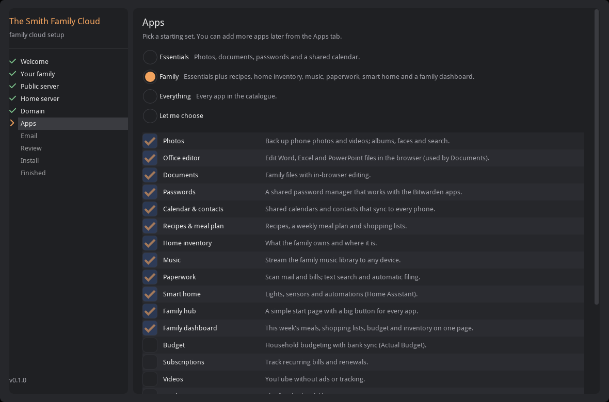
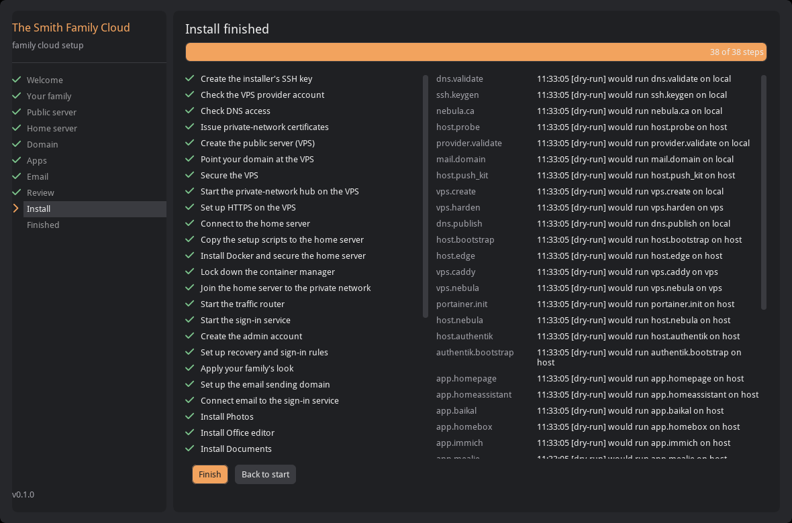
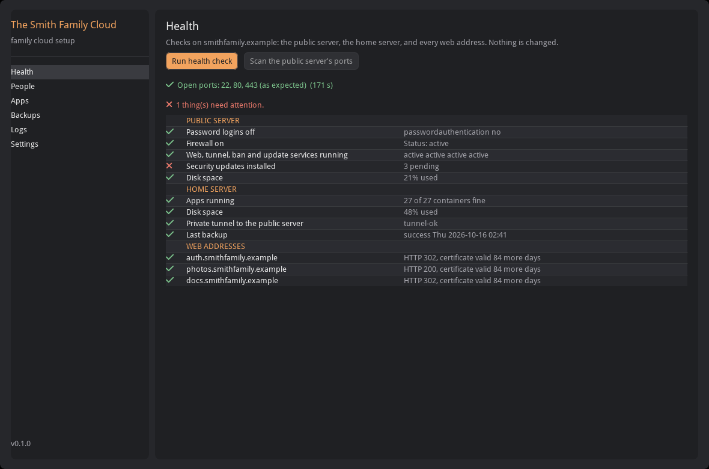
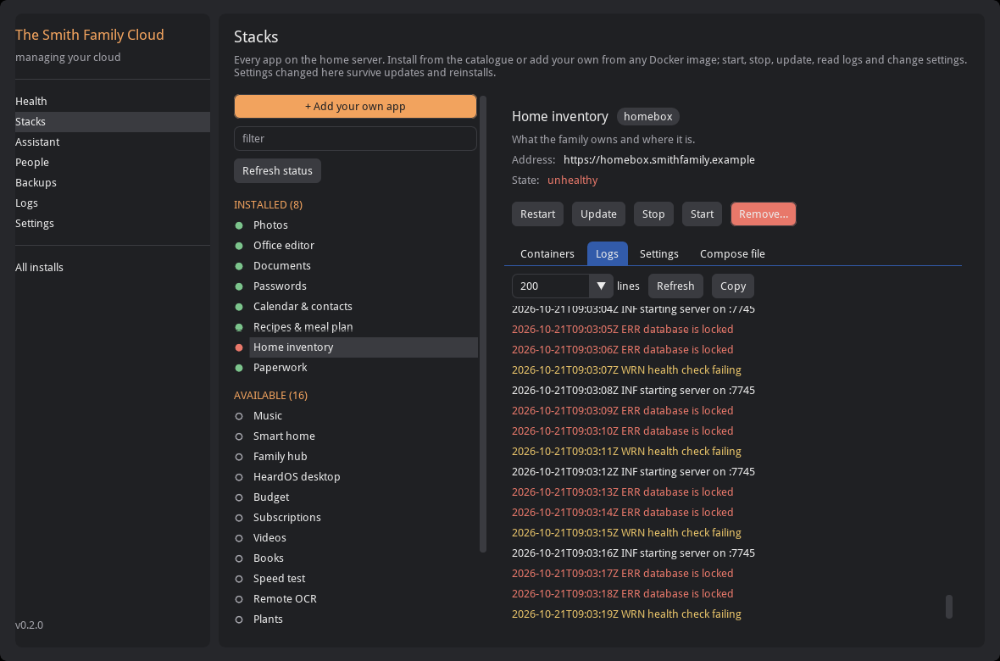
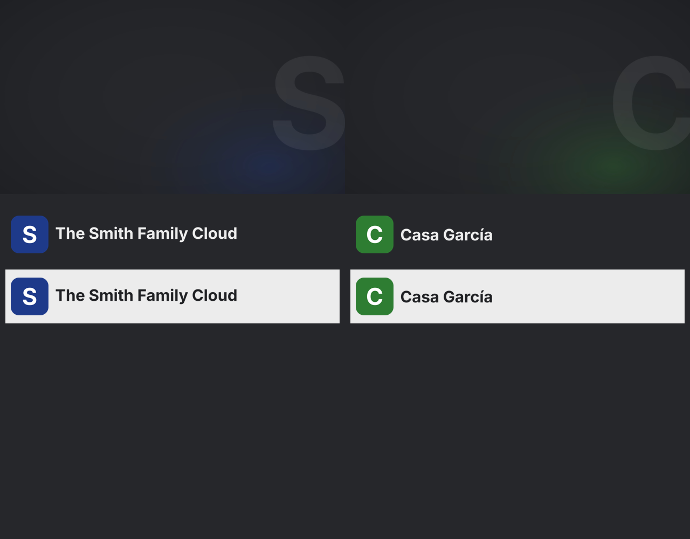

# HeardOS installer

A desktop app that builds a HeardOS family cloud from start to finish, then stays useful afterwards for the
day-to-day jobs: adding family members, installing apps, health checks and backups. It drives the scripts in this
repository (`generic/`, `authentik/`, …) so nobody has to use ssh, edit plan files or copy tokens between machines.



## What you need

| Thing | Notes |
|---|---|
| A computer to run the app | Linux, macOS or Windows. It holds your secrets vault and the private-network certificates. |
| A home server | Ubuntu 24.04 with root SSH (a password is fine the first time), 4 GB RAM or more, `/dev/net/tun`. A Proxmox LXC works once TUN is enabled. |
| A domain | One you own. DNS at Cloudflare is the easiest; any other DNS host works in manual mode. |
| A VPS provider account | Cloudzy, Linode or Vultr (the app creates a ~$5–7/month server, billed hourly), OVHcloud (~$6–11/month, billed monthly; see `docs/ovh-vps.md`), or bring your own Ubuntu VPS. |
| Optional: a Resend account | For password-reset and invitation emails. Any SMTP provider works too. |

## Install the app

**Linux** (and macOS from a terminal):

```bash
pipx install ./installer        # from a checkout of this repository; the kit is bundled into the package
heardos                          # the app;  heardos-cli --help  for the headless version
```

**Windows, macOS and Linux**: download the app from the
[latest release](https://github.com/simontemplarST/heardos-stack/releases/latest), or build it yourself:

```bash
cd installer && pip install --require-hashes -r requirements-dev.lock && pip install --no-deps --no-build-isolation -e . \
  && pyinstaller heardos.spec      # -> dist/
```

macOS builds are not notarised: the first time, right-click the app and choose Open.

## The wizard

1. **Welcome**: create the secrets vault (one passphrase, optionally remembered in the system keyring). Existing
   `~/.config/credentials.env` values can be imported.
2. **Your family**: cloud name, domain, accent colour, optional logo, and your administrator account.
3. **Public server**: provider, API token (checked live), region and plan. The nearest region and cheapest suitable
   plan are pre-selected, with the price shown.
4. **Home server**: address and login; *Test connection* checks the OS, memory, disk and TUN device.
5. **Domain**: Cloudflare token, or manual mode (the app lists the records and waits until the internet sees them).
6. **Apps**: *Essentials*, *Family*, *Everything* or pick your own. Apps that need another app pull it in (AI filing pulls in
   Paperless). The memory estimate counts each app; AI filing alone needs about 3.5 GB. Also here: the `cloud.<domain>` front
   door and **Block known attackers** (CrowdSec on the VPS, on by default; an enrolment key from app.crowdsec.net is optional).
7. **Email**: Resend (a full-access key lets the app add and verify your domain itself), SMTP, or none.
8. **Review**: everything that will be created, and what it costs. Nothing billable happens before you confirm.
9. **Install**: about an hour, mostly waiting. Steps run in parallel where they can; you can close the app and resume.
   A few steps ask you to do one thing in a browser (sign in to Documents once, finish the calendar server's setup);
   the app waits and continues by itself.
10. **Finished**: your sign-in details, shown once.



### Install order

The app works out the order from step dependencies rather than a fixed list:

| Layer | Runs together |
|---|---|
| 0 | installer SSH key, DNS token check, private-network certificate authority |
| 1 | VPS token check, first contact with the home server, email domain set-up (DNS has time to propagate) |
| 2 | create the VPS, copy the scripts to the home server |
| 3 | harden the VPS, publish DNS, install Docker at home |
| 4 | Nebula lighthouse + Caddy on the VPS, traffic router at home (certificates are issued while apps install) |
| 5 | CrowdSec on the VPS (reads Caddy's access log), while the home server joins the private network and Authentik starts |
| 6+ | admin account, brand, email, then apps one by one, then each app's first-run setup (Listmonk's waits for email so it can send; AI filing pulls its model and queues existing documents; Plants gets its hourly task cron) |
| last | verify: every web address over HTTPS, no unhealthy containers |

## After the install

Open the install from Welcome (or press *Manage my cloud*):

| Tab | What it does |
|---|---|
| Health | Read-only checks of the VPS, home server and every web address; optional full TCP port scan of the VPS |
| People | Add family members (first password shown once, or a set-your-password email), choose their apps and sign-in rules, suspend |
| Stacks | Every app: install from the catalogue, add your own from any Docker image, start/stop/restart/update, remove; per app its containers, logs, settings (kept across updates) and compose file. See [Managing stacks](../docs/stack-management.md) |
| Assistant | Ask in plain words; a model on your own hardware (Ollama, llama.cpp, LM Studio…) does it with the same tools, showing every change for approval first |
| Backups | Nightly encrypted restic backups to a disk, NAS (SFTP) or S3; back up now, list, verify |
| Logs | Every step's log, with secrets masked |
| Settings | Change name/colour/logo and re-apply, change the vault passphrase, delete the VPS |





The same jobs from a terminal:

```bash
heardos-cli list
heardos-cli status <install-id>
heardos-cli health <install-id> --scan
heardos-cli people <install-id> --add sam "Sam Smith" sam@example.net --welcome
heardos-cli retry <install-id> <step>
heardos-cli destroy <install-id>          # deletes the VPS only
heardos-cli tools <install-id>            # the stack-management tools; run one with: heardos-cli tool <install-id> <name> --args '{…}'
heardos-agent --install <install-id> "the inventory app is broken"    # the model harness (default: Ollama, llama3.2:3b)
heardos-agent --eval --model qwen2.5:7b   # score a model on ten realistic requests against a simulated install
heardos-mcp --install <install-id>        # the same tools for MCP clients (read-only unless --allow-changes)
heardos-serve --install <install-id>      # the harness behind the OpenAI/Ollama chat protocols: use it from Open WebUI, LibreChat, Hollama…
```

## Your own look

Name, colour and logo become the sign-in page, emails, family hub and app icons. Without a logo the app draws a
monogram from the family name:



## Where things are kept

| Path | Contents |
|---|---|
| `~/.config/heardos/vault.json` | Encrypted secrets (argon2id + XSalsa20-Poly1305). Back this file up together with your passphrase. |
| `~/.config/heardos/state/<id>.json` | Plan and step progress (no secrets) |
| `~/.config/heardos/logs/<id>/` | One log per step, secrets masked |
| `~/.config/heardos/nebula/<id>/` | Private-network CA. Losing it means re-issuing every certificate. |
| `~/.ssh/heardos_ed25519` | The installer's SSH key for the VPS and home server |

Set `HEARDOS_HOME` to keep all of this somewhere else. `HEARDOS_KIT` makes the app use another copy of the setup scripts
(it warns when that is not the copy it shipped with: those scripts run as root on your servers).

On Windows the app cannot restrict these files with Unix permissions (`chmod` does nothing there): the vault stays
encrypted, but the state, logs and Nebula CA key are protected only by your Windows account, so keep `HEARDOS_HOME` inside
your own user profile and do not share that account.

### Server identity and headless installs

The home server, a bring-your-own VPS and an OVHcloud VPS were not created by the app through a provider API, so before
it sends a password or runs anything it shows the server's SSH host key fingerprint and asks you to compare it with
`ssh-keygen -lf /etc/ssh/ssh_host_ed25519_key.pub` run on that server's console. A changed key later stops the install.
For `heardos-cli` without a terminal, put the expected values in the plan as `HOST_SSH_FINGERPRINT` and
`VPS_SSH_FINGERPRINT` (`SHA256:...`). An OVHcloud order is paid automatically only with `"ovh_autopay": true` in the plan
(or the Review checkbox); otherwise the install stops at the order and shows the payment link.

Store secrets with `heardos-cli secret NAME` (hidden prompt) or `printf %s "$VALUE" | heardos-cli secret NAME --value-stdin`;
values are never taken as arguments. Passwords are printed only with `--show`.

## Development

```bash
cd installer && python3 -m venv .venv && .venv/bin/pip install -e ".[dev]"
.venv/bin/pytest -q tests/unit
HEARDOS_UI_DEMO=1 .venv/bin/heardos                                    # sample data, nothing real is touched
HEARDOS_UI_DEMO=1 HEARDOS_UI_SCREEN=people HEARDOS_UI_SHOT=p.png .venv/bin/heardos   # screenshot one screen
heardos-cli install --plan tests/e2e/plan.example.json --dry-run --yes  # the whole DAG, nothing executed
```

`tests/e2e/run_e2e.sh` does a real install against a throwaway home server and an hourly VPS, runs the health check
and port scan, then deletes the VPS. Never point it at a machine you care about.

Layout: `engine/` (step DAG, runner, state, logs), `vault/`, `remote/` (SSH, kit upload, plan file), `providers/`
(Cloudzy, Linode, Vultr, OVHcloud, bring-your-own), `dns/`, `mail.py`, `brand/`, `steps/` (one function per install step),
`ops.py` (day-two jobs), `manage/` (stack management shared by the GUI, CLI and harness: backends, custom-stack specs,
the tool registry), `harness/` (the small-model agent loop, model clients, evals, MCP server), `ui/` (screens).
